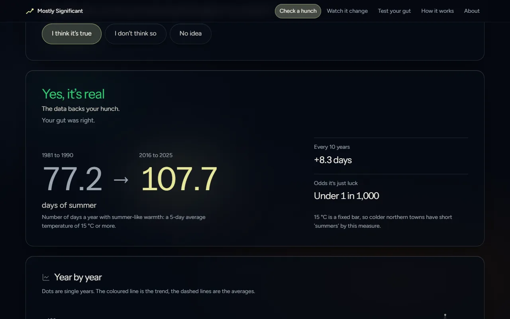

# Is it just me?

**Your weather hunches, fact-checked against 45 years of NASA data.**

Team Mostly Significant · NASA Space Apps Challenge 2026 · "Be an Earth System Trend Detective"

**Live site: [mostly-significant.vercel.app](https://mostly-significant.vercel.app)**

**Where to look**

| To see | Open |
|---|---|
| The product | the [live site](https://mostly-significant.vercel.app) |
| The method, definitions and data checks | [data-generation/README.md](data-generation/README.md) |
| The analysis code | [data-generation/src/](data-generation/src/) |
| Every verdict, in one table | [data-generation/data/results/results.csv](data-generation/data/results/results.csv) |



Everyone has a feeling about how the weather is changing: "summers are getting hotter", "we
barely get frosts any more". Memory makes a poor thermometer. This site turns each feeling
into a question, asks you to guess, then answers it with NASA data: a verdict, the size of the
change, and an honest note on what the data can't say.

## What you can do

| Page | What it does |
|---|---|
| **Home** | Ask in your own words, such as "nights are unbearable in Manchester". You get a small answer card right in the chat. |
| **Check a hunch** | Pick a place and a hunch, guess, then see the verdict, the 1980s against the last ten years, the year-by-year chart, the luck test, and the same hunch on a map of every place. |
| **Watch it change** | Every place on one map, coloured by how each year compares with its own normal. Drag through 1981 to 2025, or compare two places side by side. |
| **Test your gut** | Two games: spot the town that went the other way, and tell a real change from a data error or a grid blur. |
| **How it works** | The data, the tests, what the data can't tell you, and common questions. |
| **About** | Why we built it, what could come next, and the team. |

## The verdicts

| Verdict | Meaning |
|---|---|
| **Yes, it's real** | Very unlikely to be chance (p < 0.05), and in the direction the hunch claims |
| **Signs of it, not proven** | It points that way, but it could still be luck |
| **Not backed by the data** | No clear trend either way |
| **It's actually the opposite** | A clear trend, going the other way |

Across all 1,142 trends: 448 real, 496 signs of it, 164 not backed, 34 the opposite.

## The data and the method

- **Source:** [NASA POWER](https://power.larc.nasa.gov/), built on MERRA-2. Daily values from
  1 January 1981 to 31 December 2025, on squares about 50 km across.
- **Places:** 75: 49 UK towns and 26 world cities. UK towns get 18 hunches across heat,
  seasons, rain and wind, and sun and energy; world cities get the 10 that mean the same in
  any climate.
- **One number a year:** each hunch becomes one yearly figure, such as heatwave days or the
  date of the first frost.
- **Is there a trend?** The Mann-Kendall test (Hamed-Rao version, which allows for one year
  being like the next) gives the p-value; Sen's slope gives the change every 10 years.
- **Could it be luck?** Each series is also shuffled 1,000 times, to show how often luck alone
  makes a trend as strong.
- **Checked data:** twelve automatic checks pass, including known events such as London's
  hottest day (19 July 2022) and Storm Eunice. Grid squares that are mostly sea or lake were
  moved to the nearest land square.

The full method, every definition and the data checks are in
[data-generation/README.md](data-generation/README.md).

## The chat box

A language model works out which test a sentence is about: Google's Gemini through a small
server function (`docs/api/route.js`), or a small model (MiniLM) that runs in the browser when
Gemini can't be reached. **Neither one supplies a number.** Every figure on a card comes from
the results files, and a Gemini sentence with a number that isn't on the card is replaced by a
fixed template. A question the data can't test (a forecast, snow, or something unrelated to
weather) gets a short general answer from Gemini, marked as not coming from the NASA data.

`chat-eval/` holds 75 test questions and the script that scores both models; both pick the
right test every time on that set.

## What it can't tell you

- Each value is an average over a square about 50 km wide, so peaks read low: London's
  hottest day shows 34.5 °C, where stations recorded about 40 °C. The trends still hold.
- "Unusually hot" is relative to each place, so the bar differs from town to town.
- Rain varies a lot from year to year, so most rain hunches only reach "signs of it".
- Humidity, wind and soil come from the weather model rather than direct measurements, so
  those trends are less certain than temperature.
- Singapore's rain data is faulty from 2021, so its rain covers 1981 to 2020. Delhi has not
  been checked against weather station records.
- It shows that something changed, not why, and it is not a forecast.

## In this repository

| Folder | What it holds |
|---|---|
| [`data-generation/`](data-generation/) | Python: downloads the NASA data, checks it, builds the yearly measures, tests every trend and writes the results files |
| [`docs/`](docs/) | The website: plain HTML, CSS and JavaScript that reads the results. It calculates nothing itself |
| [`chat-eval/`](chat-eval/) | The 75 chat test questions and their scoring script |

```
NASA POWER API → data-generation/ (download, clean, measures, trend tests) → results CSVs
              → docs/data/make_data.py, make_timeline.py (JSON) → docs/ (the site)
```

## Running it locally

The site, with the on-device chat model:

```
python -m http.server 8000 --directory docs
```

The site with Gemini as well (needs `GEMINI_API_KEY` in `.env.local`, which git ignores):

```
node chat-eval/serve.mjs
```

The results are already in the repository. Rebuilding them from the NASA data is described in
[data-generation/README.md](data-generation/README.md).

## Team

Mostly Significant, London, November 2026: Naveen Herath and Bathila Jayasiri.

## Licence

MIT. See [LICENSE](LICENSE).
